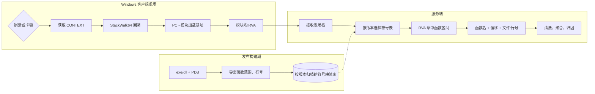

Dump---
title: 不依赖 Windows 平台上解析用户崩溃、卡顿现场调用栈的通用方案与实践
date: 2026-10-13 20:05:26 +0800
categories: [稳定性]
tags: [crash、jank、调用栈解析]
mermaid: true
published: true
---

为基于 Dump 的传统排查方案依赖 Windows 的问题，本文提出一种本地抓取调用栈、后台解析的方案，在不使用 Dump 的前提下满足后台对崩溃、卡顿问题以调用栈维度聚合分类的需求。

## 背景
Windows 客户端发生崩溃或卡顿，排查思路是回溯“异常现场”进行归因，传统排查方法是保存现场 Dump 并上传，解析 Dump 具体分析软件崩溃、卡顿时发生的状态信息（最关键的是崩溃、卡顿线程的调用栈），并按照线程、**调用栈（关键）**等维度进行问题聚合输出优化项（**Top 问题**）。

### 目的
线上解析后台不依赖 Dump 实现调用栈解析，并对解析后的调用栈清洗、聚合，最后找到出现次数最多的调用栈（即头部问题），输出重点优化项。

### 主要问题
基于解析 Dump 的传统方案，线上解析后台必须部署 Windows 并使用 WinDbg 等工具来解析 Dump。而公司缺乏 Windows 基建与经验，且因 Dump 解析系统的开发成本较高，不愿意投入人力开发 PC 基建。


## 2. 传统 Dump 方案

### 2.1 传统 Dump 方案

传统流程通常是：

1. 崩溃处理器或卡顿监控逻辑调用 `MiniDumpWriteDump`生成 Dump 文件；
2. 将 `crash.dmp` 或 `jank.dmp` 上传；
3. 在 Windows 服务器上用 WinDbg、CDB 或 DbgEng 打开 Dump；
4. 加载对应版本的 exe、dll 和 PDB；
5. 通过 `.ecxr; kn`、`~*kn` 等命令解析崩溃线程或所有线程的调用栈；
6. 清洗系统模块栈帧并进行问题聚合。

传统方案的信息量大，除了调用栈，还可以保留寄存器、线程、内存和异常上下文。
它适合少量高价值问题的深度诊断，也是无 Dump 方案的重要兜底手段。

### 2.2 传统 Dump 方案在线上规模化场景中的代价

- **上传体积大**：Dump 通常远大于几百字节的栈文本，网络和存储成本更高；
- **解析速度慢**：每份 Dump 都要加载调试引擎、镜像和符号，批量解析成本高；
- **服务端依赖 Windows**：解析服务需要 Windows 环境及对应的调试组件；

关键问题是**服务端依赖 Windows**，但公司缺乏 Windows 基建与经验，且因**开发成本较高**，不愿意为 Windows 端单独开发一套 Dump 解析系统。


## 关键问题的分析与调研

### 解析调用栈并聚合一定要依赖 Dump 吗？

#### 解析调用栈并聚合依赖的最小单元:模块名 + 相对虚拟地址（RVA）

虚拟地址不能直接上传

进程启用 ASLR 后，同一个函数在不同进程中的绝对地址可能不同。例如一次运行中
某函数位于：

```text
0x00007FF612341000
```

另一次运行可能位于：

```text
0x00007FF702781000
```

这个绝对地址不适合作为问题指纹。

模块加载后，函数地址相对于模块加载基址的偏移通常稳定，因此将：

```text
RVA = PC - module_base
```

作为上传数据。现场栈帧可以表示为：模块 + RVA

```text
capture-stack-mvp.exe!0x12f60
KERNEL32.DLL!0x2cd87
ntdll.dll!0xacaec
```

服务端只需知道当前版本 `capture-stack-mvp.exe` 的符号范围，即可把
`0x12f60` 映射回函数。

>RVA 只在同一次构建对应的二进制和 PDB 之间有效。不能仅按模块文件名查表，否则不同版本中同一个 RVA 可能对应不同函数。

一起上传的生产数据至少还应包含：

```text
应用版本 / 发布版本
模块名
模块身份标识
事件类型：crash 或 jank
线程 id 和线程名（如果可用）
```

应用版本适合查询和聚合，PDB/PE 标识适合做最终一致性校验。

实验中的传统方案还验证了两个实现细节：

- 被挂起线程的栈内容不一定直接位于 `MINIDUMP_THREAD.Stack` 指向的位置，自己用
  `MiniDumpReadDumpStream` 加 `StackWalk64` 解析时容易取错数据；
- 默认 MiniDump 通常不包含完整的模块展开信息，解析机仍需要访问同版本镜像和符号。

因此，可以把两种方案组合使用：

- **高频问题**：上传轻量的 `模块 + RVA` 栈，走跨平台快速聚合；
- **低频疑难问题**：仍上传 Dump，但不在线上解析，只有在单点分析时下载具体 case 的 Dump 文件，使用 Windows 调试器深度分析。

## 基于本地调用栈捕获的方案

前文已知解析调用栈并聚合依赖的最小单元是栈帧 `模块名 + 相对虚拟地址（RVA）`，而不是 Dump 文件。

基于此前提，提出**本地调用栈捕获**的方案是：

1. **现场采集阶段**：Windows 客户端只使用系统调试能力回溯目标线程的调用栈；
2. **现场输出阶段**：记录每个栈帧 `模块名 + 相对虚拟地址（RVA）`；
3. **发布构建阶段**：用与二进制完全匹配的 PDB 预先导出函数范围和源代码行映射；
4. **服务端解析阶段**：服务端只读取文本或二进制符号映射表，按 `模块 + RVA` 查找函数和行号；
5. **问题聚合阶段**：对符号化后的应用栈帧进行清洗、归一化和聚合。

核心数据流如下：



>以上方法的好处是**现场数据上传后的解析服务不依赖 Windows**。Windows客户端仍需调用 Windows API 和 DbgHelp 完成现场采集；发布期从 PDB 生成映射表时，也通常需要 Windows 下的 DIA 或 DbgHelp 工具。真正被移出线上服务的是 PDB 解析和 Windows 调试器依赖。


### Windows 客户端如何采集调用栈

示例代码位于外部实践资料的：

```text
D:\projects\不依赖 Windows 的调用栈解析方案\调用栈方案\capture-stack-mvp.cc
```

该实现展示了崩溃和卡顿两条路径。

#### 崩溃路径

崩溃时通过 `SetUnhandledExceptionFilter` 注册异常过滤器。系统传入的
`EXCEPTION_POINTERS` 中包含故障线程的 `CONTEXT`，其中保存了崩溃发生时的 PC、
SP、FP 等寄存器。

基本流程：

1. 从 `EXCEPTION_POINTERS->ContextRecord` 复制 `CONTEXT`；
2. 设置需要读取的 `ContextFlags`；
3. 以异常上下文作为第一帧；
4. 调用 `StackWalk64` 逐帧回溯；
5. 对每个 PC 查找所属模块；
6. 输出 `模块基名!0xRVA`；
7. 继续原有异常处理流程，让系统生成正常的崩溃结果。

崩溃回调必须尽量短小。回调中不应执行复杂业务逻辑、网络请求或不可控的内存分配。
实践中的 DbgHelp 调用是 best-effort：如果进程已经处于堆损坏、锁竞争或加载器异常
状态，现场采集可能失败。

#### 卡顿路径

卡顿通常没有异常上下文，需要由 watchdog 线程或外部监控进程主动获取目标线程状态。
示例采用：

1. watchdog 等待卡顿阈值；
2. `OpenThread` 获取目标线程句柄；
3. `SuspendThread` 暂停目标线程；
4. `GetThreadContext` 获取寄存器现场；
5. `StackWalk64` 回溯调用栈；
6. 无论成功或失败都调用 `ResumeThread`；
7. 关闭线程句柄并上报结果。

挂起目标线程是为了让寄存器和栈内存保持在同一个瞬间。如果目标线程继续运行，
回溯过程可能读到已经变化的栈，最终产生错乱的调用链。

> 生产环境更建议**外部 watchdog 进程**

示例为了展示流程，在同一进程内由另一个线程挂起目标线程。这种方式存在风险：

- 目标线程可能正持有堆锁、Loader Lock 或业务锁；
- 采集线程调用内存分配、文件 IO 或 DbgHelp 时，可能再次等待这些锁；
- 目标线程被挂起后无法释放锁，导致采集线程也卡死；
- 采集失败时如果遗漏 `ResumeThread`，目标线程会永久挂起。

生产实现更适合使用独立 watchdog 进程：

```text
watchdog.exe
  ├─ 监控目标进程心跳或 IPC
  ├─ OpenProcess / OpenThread
  ├─ 挂起目标线程并读取 CONTEXT
  ├─ 在监控进程中完成回溯或读取必要数据
  └─ 保证恢复线程、关闭句柄、超时退出
```

外部进程不能消除所有权限和现场一致性问题，但可以把采集器与目标进程的堆、
锁和运行时状态隔离开，显著降低自死锁风险。

## 5. 调用栈回溯的实现要点

### 5.1 初始化 DbgHelp

`SymInitialize`、`SymCleanup`、`StackWalk64`、模块枚举等 DbgHelp 能力需要统一管理。
实践代码使用全局互斥锁保护 DbgHelp 调用，因为 DbgHelp 的符号处理状态不是线程安全的。

建议：

- 进程级初始化一次，避免每次事件都重复初始化和清理；
- 所有共享 DbgHelp 状态的操作使用同一把锁；
- 设置最大栈帧数，例如 128，防止损坏栈导致无限回溯；
- 对输出文件、句柄、挂起状态使用 RAII 或统一清理路径；
- 采集失败时记录明确的错误码和阶段。

### 5.2 枚举模块并计算 RVA

调用 `EnumerateLoadedModulesW64` 获取模块基址、模块大小和模块路径。输出时只保留
模块基名，避免上传用户机器上的绝对路径。

伪代码如下：

```cpp
for each frame:
    pc = frame.AddrPC.Offset
    module = find module where module.base <= pc < module.base + module.size
    if module exists:
        output module.basename + "!0x" + hex(pc - module.base)
    else:
        output "???!0x" + hex(pc)
```

需要注意：

- 模块区间判断必须使用加载基址和模块映像大小；
- 未知模块不要强行归入应用模块；
- 模块名比较、版本匹配和聚合时应统一大小写；
- x64、x86、ARM64 的 PC、SP、FP 字段不同，必须按目标架构初始化
  `STACKFRAME64`；
- 回溯函数需要使用与目标架构匹配的 `machine_type`。

### 5.3 首帧和返回地址

崩溃首帧通常是当前精确 PC；后续帧一般是函数返回地址。这个差异会影响源代码行
映射：

- 首帧可直接按 `RVA` 查行号；
- 后续帧通常应按 `RVA - 1` 查行号，使其落在调用指令所在的源代码行。

示例的 `symbolize-stack.exe` 已实现这一规则。

## 6. 发布期生成符号映射表

### 6.1 为什么不把 PDB 放到客户端

PDB 可能暴露函数名、源文件路径、类型和内部结构信息。商业软件通常不能把完整
PDB 随客户端分发。因此客户端只负责采集地址，符号保留在构建或服务端环境。

### 6.2 映射表的最小内容

每个应用模块至少需要导出函数区间：

```text
函数起始 RVA
函数大小
函数名
```

如果希望解析到源代码行，还需要导出：

```text
行信息对应 RVA
源文件路径
行号
```

实践资料中的 `pdbmap.exe` 使用 DIA 从 PDB 导出统一映射文件，记录格式为：

```text
F<TAB>函数 RVA<TAB>函数大小<TAB>函数名
L<TAB>代码 RVA<TAB>行号<TAB>源文件路径
```

其中函数和行号已经是相对于镜像基址的 RVA，服务端不需要加载 PDB，也不需要
调用 Windows 调试 API。

### 6.3 建议的构建流水线

```text
编译 exe/dll + PDB
        |
        v
校验 PE 与 PDB 的 GUID/Age
        |
        v
DIA 导出函数范围和行号
        |
        v
生成 map 文件并压缩、校验、归档
        |
        v
上传符号存储或符号服务
```

映射表必须和发布产物绑定归档，不能在发布完成后仅凭文件名重新猜测对应关系。
建议把以下信息写入映射表元数据：

```text
application
release
module_name
module_size
pe_timestamp
pdb_guid
pdb_age
architecture
compiler/toolchain
```

### 6.4 旧版 `pdbDump` 方案

实践资料还验证了使用 `pdbDump.exe -sa -csv` 导出符号，再由解析器读取 CSV。
该方式可以作为过渡方案，但有一个容易出错的地方：

`pdbDump.exe` 示例会把模块加载在 `0x400000`，导出的符号地址是加载地址，
因此必须先减去 `0x400000` 才能得到真实 RVA。

更推荐直接使用已经输出 RVA 的 DIA 映射格式，避免把固定加载基址作为隐含约定。

## 7. 服务端如何离线符号化

示例解析器位于：

```text
D:\projects\不依赖 Windows 的调用栈解析方案\调用栈方案\symbolize-stack.cc
```

它的输入是：

```text
栈文件：模块名!0xRVA
映射表：函数范围和行号范围
目标模块：当前要解析的应用模块
```

### 7.1 函数查找

将映射表按函数起始 RVA 升序排列。对于输入 RVA，找到满足以下条件的函数：

```text
function_rva <= frame_rva < function_rva + function_size
```

可以使用二分查找定位候选函数，再检查函数区间。解析结果包含函数名和函数内偏移：

```text
capture-stack-mvp.exe!0x12f60
  -> CrashWork+0x0
```

函数内偏移对于不同编译优化、函数大小变化和问题聚合很有帮助。聚合时可以按
函数名聚合，也可以按函数名加较粗粒度偏移聚合。

### 7.2 源代码行查找

函数解析成功后，再在该函数范围内按 RVA 查找最近的行号记录：

```text
capture-stack-mvp.exe!0x12f60
  -> CrashWork+0x0
  at capture-stack-mvp.cc:256
```

对非首帧使用 `RVA - 1`，避免返回地址正好落到下一条源代码行。

### 7.3 未知帧和部分成功

符号化器不应该因为单个栈帧解析失败而丢弃整条调用栈。建议：

- 目标模块成功解析的帧输出函数名；
- 系统模块和未知模块保留原始 `模块!RVA`；
- 格式错误的行标记为 malformed；
- 返回解析统计，例如总帧数、目标模块帧数、成功数；
- 部分成功时保留原始栈，方便后续补符号或重新解析。

示例输出：

```text
capture-stack-mvp.exe!0x12f60
  -> CrashWork+0x0 at capture-stack-mvp.cc:256
KERNEL32.DLL!0x2cd87
ntdll.dll!0xacaec
```

## 8. 实践验证

### 8.1 构建采集器

在 Visual Studio x64 Native Tools 命令行中：

```bat
cl.exe /nologo /W4 /EHsc /Zi /Od /Ob0 /std:c++17 capture-stack-mvp.cc
```

`/Od /Ob0` 主要用于让 Demo 的调用链更容易观察。生产版本必须用实际发布编译
选项验证，不能因为 Demo 禁用内联就假设线上也能得到同样的栈。

### 8.2 采集卡顿栈和崩溃栈

卡顿场景：

```bat
capture-stack-mvp.exe --jank
type jank-stack.txt
```

崩溃场景：

```bat
capture-stack-mvp.exe --crash
type crash-stack.txt
```

`--crash` 会故意触发访问违规，异常过滤器执行后进程会异常退出，这是预期行为。

### 8.3 生成映射表并解析

```bat
pdbmap.exe capture-stack-mvp.pdb capture-stack-mvp-map.txt

symbolize-stack.exe --map capture-stack-mvp-map.txt ^
  --stack jank-stack.txt ^
  --module capture-stack-mvp.exe ^
  --out jank-stack.mapped.txt
```

实验结果中，崩溃栈可以解析为：

```text
capture-stack-mvp.exe!0x12f60
  -> CrashWork+0x0
capture-stack-mvp.exe!0x12f89
  -> SimulateCrash+0x9
capture-stack-mvp.exe!0x131f9
  -> wmain+0x229
```

卡顿栈可以解析为：

```text
capture-stack-mvp.exe!0x12f2f
  -> JankWork+0xf
capture-stack-mvp.exe!0x12f49
  -> SimulateJank+0x9
capture-stack-mvp.exe!0x1319d
  -> wmain+0x1cd
```

系统模块帧仍然保留为：

```text
KERNEL32.DLL!0x2cd87
ntdll.dll!0xacaec
```

这说明方案已经完成了核心闭环：客户端没有加载 PDB，解析工具也没有加载
Windows Dump 或调用 Windows 调试引擎。

## 9. 局限性与处理策略

### 9.1 内联函数不会自然出现在原始栈帧中

函数被内联后，调用方和被调用方共享机器码，通常不会形成独立栈帧。仅凭没有 PDB
参与的 `StackWalk64` 结果，无法可靠还原所有内联调用层级。

实践中：

- 未禁用内联时，可能只能看到外层函数；
- 使用 `/Ob0` 禁用内联后，Demo 可以看到更完整的函数链；
- 生产环境不建议为了采集调用栈全局禁用内联，因为会影响性能和代码布局；
- 可以研究通过 `SymEnumSymbolsEx + SYMENUM_OPTIONS_INLINE` 导出内联符号，再在服务端
  结合行号和内联信息推导，但这属于额外扩展，不能把普通函数范围表当成完整的
  内联调用树。

### 9.2 优化会改变调用链

尾调用、函数合并、异常展开信息、寄存器分配和栈帧省略都可能影响回溯结果。
因此验收时必须覆盖实际编译选项、x64/x86/ARM64 架构和真实运行时库。

### 9.3 系统模块和驱动模块符号不稳定

系统 DLL、显卡驱动和第三方注入模块的符号受操作系统版本、驱动版本和符号可用性
影响。一般实践是：

1. 优先解析和聚合自有模块；
2. 系统模块保留 `模块 + RVA` 作为上下文；
3. 只有在确实需要系统内部函数时，才按版本维护对应模块和符号；
4. 不把系统模块解析失败视为整条栈解析失败。

### 9.4 采集器本身不是绝对安全

异常过滤器执行时，进程状态可能已经损坏。以下操作都可能失败：

- 堆分配；
- 文件写入；
- 获取模块列表；
- DbgHelp 初始化；
- 线程回溯；
- 日志输出。

生产采集器应该允许降级：

```text
完整符号栈
    -> 模块 + RVA 栈
    -> 当前 PC / 异常码 / 线程 ID
    -> 仅上报崩溃元数据
```

高可靠实现还应考虑预分配缓冲区、预打开文件、独立 watchdog、超时和进程级兜底。

### 9.5 卡顿线程选择很重要

“卡顿线程”不能简单等同于 UI 线程。应结合业务定义选择目标线程，例如：

- UI 消息循环长时间无响应；
- 渲染线程连续多个周期未完成；
- 关键任务线程心跳超时；
- 线程 CPU 持续占用但没有进度；
- 线程阻塞在锁、IO、Sleep 或等待对象上。

上报时建议同时带上线程角色、线程名、线程 ID 和卡顿持续时间。

## 10. 生产落地建议

### 10.1 推荐的端到端流程

```text
发布构建：
  编译产物 -> 校验 PDB -> 导出 map -> 绑定 release/module identity -> 归档

客户端：
  触发崩溃/卡顿 -> 获取 CONTEXT -> 回溯 -> 输出模块!RVA -> 低成本上报

服务端：
  校验 release/module identity -> 读取 map -> 二分查函数/行号
  -> 过滤系统帧 -> 规范化调用栈 -> 聚合问题

疑难问题：
  命中采样或人工策略 -> 额外上传 Dump -> Windows 调试链路深度分析
```

### 10.2 上报协议建议

示例：

```json
{
  "event_type": "crash",
  "app_version": "1.8.0",
  "build_id": "2026-10-13.001",
  "architecture": "x64",
  "thread": {
    "id": 1234,
    "role": "ui",
    "name": "MainThread"
  },
  "modules": [
    {
      "name": "capture-stack-mvp.exe",
      "pdb_guid": "....",
      "pdb_age": 1
    }
  ],
  "frames": [
    "capture-stack-mvp.exe!0x12f60",
    "capture-stack-mvp.exe!0x12f89",
    "KERNEL32.DLL!0x2cd87",
    "ntdll.dll!0xacaec"
  ]
}
```

实际协议可以使用更紧凑的整数编码，但语义应保持一致。尤其不要只上传一串没有
版本信息的模块名和 RVA。

### 10.3 调用栈归一化

聚合前建议：

- 统一模块名大小写；
- 过滤或截断系统模块；
- 过滤采集器自身的公共启动帧；
- 对函数内偏移做保留或分桶；
- 记录原始栈和归一化栈；
- 对解析失败率、未知模块率、符号版本不匹配率建立监控。

一个实用的聚合键可以是：

```text
事件类型 + 应用版本 + 自有模块调用栈前 N 帧
```

疑难问题分析则应保留完整原始栈，不能只存聚合键。

## 11. 方案对比

| 维度 | 传统 Dump | 无 Dump 的模块 + RVA |
| --- | --- | --- |
| 现场数据 | Dump、线程、内存、寄存器 | 选定线程的调用栈 |
| 上传体积 | 通常较大 | 通常几百字节到几 KB |
| 服务端依赖 | Windows + 调试引擎/符号 | 任意能读取映射表的平台 |
| 解析速度 | 单份较慢，资源消耗高 | 查表快，适合批量聚合 |
| 隐私风险 | 可能包含堆栈和业务数据 | 主要是地址和元数据 |
| 内联帧 | 调试器通常可见 | 普通 RVA 栈无法完整恢复 |
| 系统模块 | 可依赖符号服务器 | 通常保留原始模块 + RVA |
| 适用场景 | 疑难问题、深度诊断 | 高频问题、线上聚合 |

## 12. 验收清单

上线前至少验证以下项目：

- [ ] x64、x86、ARM64 的 `CONTEXT` 和 `StackWalk64` 路径；
- [ ] 崩溃首帧、后续返回地址和 `RVA - 1` 行号规则；
- [ ] 卡顿线程能够可靠恢复，失败路径不会遗留挂起线程；
- [ ] DbgHelp 并发调用不会互相破坏；
- [ ] 现场模块身份和服务端映射表严格匹配；
- [ ] 发布版本、灰度版本和回滚版本的符号表可追溯；
- [ ] 内联、尾调用、优化级别变化下的解析率；
- [ ] 系统模块、第三方模块和未知模块的降级行为；
- [ ] 符号缺失、映射表损坏、版本不匹配时仍保留原始栈；
- [ ] 上报内容不包含用户机器绝对路径、堆内存或敏感业务数据；
- [ ] 高频事件下的上传、存储、符号化和聚合资源消耗；
- [ ] Dump 兜底策略和人工取证链路可用。

## 13. 总结

这套方案的关键不是“在服务端重新实现一个 Windows 调试器”，而是把一次调用栈
解析拆成两个时机：

- **现场只做必须做的事**：获取上下文、回溯栈、计算模块 RVA；
- **发布期和服务端做可复用的事**：预生成符号索引、按版本查表、统一聚合。

这样既保留了 Windows 客户端获取真实现场的能力，又让线上解析服务摆脱 Dump、
PDB 和 Windows 调试引擎依赖。它不能完全替代 Dump：内联、优化、系统模块和损坏
现场仍然需要更重的诊断手段。因此，推荐把“模块 + RVA”作为高频问题的默认链路，
把 Dump 作为按需启用的深度诊断链路，两者共同构成完整的崩溃、卡顿现场分析体系。
